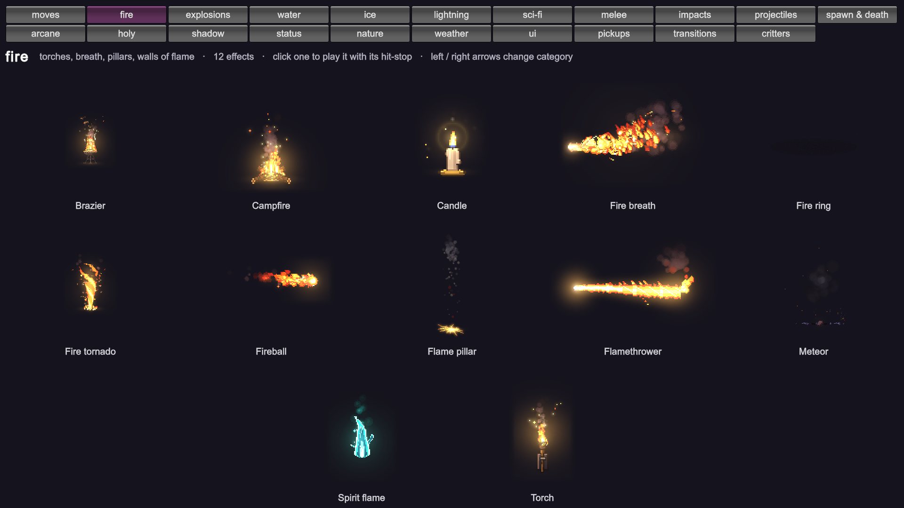
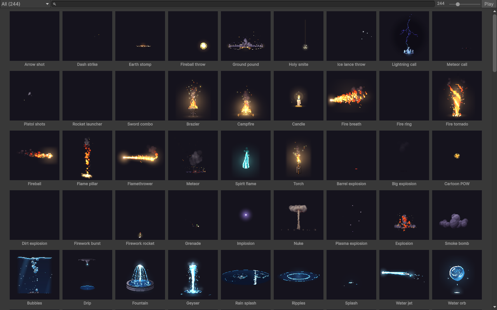

<p align="center">
  
</p>

# PixelFX for Unity

**244 个像素风特效，开箱即用的 Unity 资产。** 火焰、爆炸、魔法、天气、UI、拾取物、小生物……
每个特效都有切好的精灵、一个 `PixelFxAsset`、一个可直接拖进场景的预制体，外加播放组件、带辉光的着色器和编辑器图库。

这是 [patch-gg/pixelfx](https://github.com/patch-gg/pixelfx)（Patch 出品，MIT）的**非官方 Unity 移植**：
特效全部由 pixelfx 0.3.1 的原始代码逐帧烘焙而来，画面与原版一致。原版的方法论来自
[Hugo Duprez](https://www.spritefusion.com/blog/how-to-make-good-pixel-art-effects-with-claude)。

[English](#english) · [安装](#安装) · [快速上手](#快速上手) · [命中与定格](#命中与定格) · [渲染说明](#渲染说明) · [内存](#内存) · [重新烘焙](#重新烘焙) · [许可](#许可)

## 都有什么

| 分类 | 数量 | 举例 |
|---|---|---|
| **moves** 整套招式 | 12 | arrow shot, dash strike, earth stomp, fireball throw, ground pound… |
| **fire** 火焰 | 12 | brazier, campfire, candle, fire breath, fire ring… |
| **explosions** 爆炸 | 12 | barrel explosion, big explosion, cartoon POW, dirt explosion, firework burst… |
| **water** 水 | 12 | bubbles, drip, fountain, geyser, rain splash… |
| **ice** 冰 | 10 | blizzard vortex, freeze, frost breath, frost nova, ice crystal… |
| **lightning** 闪电 | 11 | ball lightning, chain lightning, charge up, electrified, lightning strike… |
| **sci-fi** 科幻 | 12 | EMP blast, energy core, force field, glitch, hologram… |
| **melee** 近战 | 12 | claw swipe, dagger flurry, double slash, hammer smash, heavy cleave… |
| **impacts** 打击 | 11 | blunt hit, bullet impact, critical hit, ground slam, heavy landing… |
| **projectiles** 投射物 | 13 | arrow, bullet tracer, cannon shot, energy disc, signal flare… |
| **spawn & death** 出生与死亡 | 10 | coin drop, disintegrate, dissolve burn, egg hatch, poof… |
| **arcane** 奥术 | 12 | arcane beam, arcane missiles, arcane orb, blink in, blink out… |
| **holy** 神圣 | 10 | blessing, divine shield, feather burst, halo, healing ring… |
| **shadow** 暗影 | 12 | black hole, curse, dark explosion, eclipse, grasping hands… |
| **status** 状态 | 13 | bleeding, burning, charmed, confused, cursed… |
| **nature** 自然 | 13 | acid splash, boulder, earth spike, healing bloom, leaf storm… |
| **weather** 天气 | 12 | aurora, blizzard, cherry blossoms, clouds, falling leaves… |
| **ui** 界面 | 12 | achievement, coin collect, combo counter, confetti, countdown… |
| **pickups** 拾取物 | 11 | chest open, coin spin, collect burst, crystal shard, gem spin… |
| **transitions** 转场 | 10 | blinds, burn away, CRT off, diamond wipe, glitch wipe… |
| **critters** 小生物 | 12 | bat, bird, butterfly, eyeball, fish school… |

其中 108 个是无缝循环，136 个是一次性播放；43 个带命中时间点（定格、震屏、击退力度）。

<p align="center">
  
</p>

## 安装

**方式一：Package Manager（推荐）。** `Window > Package Manager > + > Install package from git URL…`，填入：

```
https://github.com/BaronCyrus/PixelEffects.git?path=/Packages/com.baroncyrus.pixelfx
```

**方式二：克隆整个工程。** 本仓库本身就是一个 Unity 工程（Unity 6000.6 + URP），克隆后直接打开，
运行 `Assets/PixelFXDemo/PixelFXShowcase.unity` 就能看到上面的演示。

**方式三：** 把 `Packages/com.baroncyrus.pixelfx` 整个文件夹拷进你工程的 `Packages/` 目录。

环境要求见[兼容性](#兼容性)。贴图是普通 git 对象（没有走 Git LFS），克隆、下载 ZIP、git URL 安装都能拿到真实文件；
整个包约 190 MB。

## 快速上手

**不写代码：** 打开 `Window > PixelFX Gallery`，搜索或按分类浏览，把特效拖进场景或层级面板（双击则放到 Scene 视图正中）。
也可以在 Project 窗口里直接用 `Packages/PixelFX/Effects/<分类>/<名字>.prefab`。

**写代码：**

```csharp
using PixelEffects;
using UnityEngine;

public class Mage : MonoBehaviour
{
    [SerializeField] PixelFxAsset frostNova;   // 拖入 Effects/ice/frost-nova.asset
    [SerializeField] PixelFxAsset aura;        // 一个循环特效

    PixelFxPlayer auraPlayer;

    void Cast()
    {
        // 一次性特效：播完自动回收到对象池
        PixelFx.Spawn(frostNova, transform.position);
    }

    void StartAura()
    {
        // 循环特效：一直播放，直到你停掉它
        auraPlayer = PixelFx.Spawn(aura, transform.position, transform);
    }

    void StopAura()
    {
        auraPlayer.FadeOut();                   // 0.3 秒淡出后回收；Stop() 则立刻结束
    }
}
```

`PixelFx.Spawn` 返回一个 `PixelFxPlayer`，它就是挂在预制体上的那个组件：

| 属性 | 作用 |
|---|---|
| `Effect` | 要播放的特效 |
| `Loop` | `Auto`（按特效本身）、`Loop`（强制循环）、`Once`（强制只播一次） |
| `Speed` / `UnscaledTime` | 播放速度；是否无视 `Time.timeScale` |
| `RepeatDelay` | 一次性特效被强制循环时，两次播放之间的间隔 |
| `WhenFinished` | 播完后：`None` 停在末帧、`Hide`、`Deactivate`、`Destroy`（一次性特效的预制体默认 `Destroy`） |
| `HitStop` | 命中瞬间按特效自带的时长定格 |
| `HueShift` | 色相偏移（度）：让火烧成蓝色、治疗发出粉光 |
| `Intensity` | 亮度；大于 1 时把辉光推进 HDR，配合 Bloom 使用 |
| `Renderer` | 背后的 `SpriteRenderer`：翻转（`flipX`）、染色与透明度（`color`）、排序层都在这里设 |

方法：`Play()`、`Play(effect)`、`Pause()`、`Resume()`、`Stop()`、`FadeOut(seconds)`、`Seek(seconds)`、`Tick(deltaTime)`。
事件：`Hit`、`Finished`（C# 事件），以及 Inspector 里可以连线的 `OnHit`、`OnFinished`。

有方向的特效一律朝右，用 `Renderer.flipX` 或旋转 Transform 来改方向。每一帧的轴心都在特效的原点上
（火焰脚下的地面、打击的接触点），所以把物体放在"地面那一点"就对了。

## 命中与定格

打击感来自特效之外的东西：出手前的蓄力、接触瞬间的定格、镜头的一震。原版给 73 个特效标注了这些时间点，这里原样带了过来：

```csharp
var slash = PixelFx.Spawn(swordSlash, hitPoint);
slash.HitStop = true;                           // 特效自己在命中时定格
slash.Hit += (player, hit) =>
{
    // hit.time 命中时刻（秒）  hit.freeze 定格时长  hit.shake / hit.amplitude 震屏时长与幅度（像素）  hit.push 击退力度
    cameraShake.Shake(hit.shake, hit.amplitude / 16f);
    enemy.Stagger(hit.freeze, hit.push);
};
```

`PixelFxAsset` 上还有 `windup`（特效第一帧之前角色蓄力多久）和 `recovery`（最后一帧之后收招多久），
用来对齐你自己角色的动画：提前 `windup` 秒开始播放蓄力动作，再生成特效。

## 渲染说明

- **必须使用 `PixelFX/Sprite` 材质。** pixelfx 每帧有两个缓冲：`color`（按透明度混合的像素）和 `light`（叠加的辉光）。
  精灵表里存的是 `rgb = color.rgb × color.a + light.rgb`、`a = color.a`，一次预乘混合（`Blend One OneMinusSrcAlpha`）
  就能同时完成"颜色盖在背景上、辉光加在上面"。纯辉光像素的 alpha 是 0，所以用默认的 Sprites/Default 材质会丢掉所有辉光。
  预制体和 `PixelFx.Spawn` 已经配好了材质；`PixelFxPlayer` 默认也会自动换上。
- **不受光照影响**，SpriteRenderer 的排序层、遮罩之外的功能照常可用。着色器基于内置的 sprite include 编写，
  在 URP 17 的 Universal Renderer 下做过画面验证；内置管线下能正常编译，但没有做画面比对。
- **线性色彩空间：** 原版在 gamma 空间里合成。Gamma 工程里结果逐像素一致；Linear 工程里在黑色背景上一致，
  在亮背景上辉光会略暗一些。嫌暗就调高 `Intensity`。
- **像素对齐：** 精灵是 16 像素 / 单位（PPU）、点采样、无压缩。想换 PPU：把包嵌入工程后改
  `Effects/PixelFxLibrary.asset` 的 `Pixels Per Unit`，再执行 `Tools > PixelFX > Rebuild Effects`；或者直接缩放 Transform。

## 内存

贴图是未压缩的 RGBA32，这样像素才精确。逐帧裁掉了空白、重复帧只存一份，单页不超过 2048×2048。

- 244 个特效里有 200 个不到 8 MB，中位数约 2.7 MB。
- 14 个超过 32 MB，基本都是铺满屏幕的长循环：`weather` 分类的大多数在 60–80 MB。用到它们时请留意，
  或者按[重新烘焙](#重新烘焙)用 `--fps 15` 减半，或在嵌入的包里给这些贴图开启压缩。
- **不要在游戏里引用 `PixelFxLibrary`**：它引用了全部特效，会把 1.7 GB 贴图全打进包里。只引用你用到的特效。

## 重新烘焙

想升级到新版 pixelfx、烘焙你自己写的特效、换调色板或帧率：

```bash
git clone https://github.com/patch-gg/pixelfx
```

```bash
node Packages/com.baroncyrus.pixelfx/Tools~/bake.mjs ./pixelfx Packages/com.baroncyrus.pixelfx/Effects
```

然后在 Unity 里执行 `Tools > PixelFX > Rebuild Effects`。它会原地更新精灵、资产和预制体，已有引用不会断。
细节见 [Tools~/README.md](Packages/com.baroncyrus.pixelfx/Tools~/README.md)。Node 18+ 或 Bun 均可，无其他依赖。

## 兼容性

- 开发与实机验证（画面、命中事件、对象池、图库窗口）：**Unity 6000.6.5f1 + URP 17.6**，Linear 色彩空间，macOS。
- 导入与编译验证（空白工程、内置管线，244 个特效的精灵 / 资产 / 预制体全部正常加载，脚本与着色器零错误）：
  **Unity 2022.3.62f2** 和 **Unity 6000.3.15f1**。这两个版本下没有做画面比对。
- 最低版本：Unity 2022.3。
- 依赖 `com.unity.2d.sprite`（内置包，会自动装上）。
- 没有移植的部分：原版的运行时程序化渲染（调色板 / 种子 / 任意分辨率）、内置假人角色的表演动画、Claude Code skill。
  这里的特效是烘焙好的帧序列，换色请用 `HueShift`、染色，或者改调色板后重新烘焙。

## 目录结构

```
Packages/com.baroncyrus.pixelfx/      ← Unity 包本体
  Runtime/                            PixelFxAsset、PixelFxPlayer、PixelFx、PixelFxLibrary、着色器与材质
  Editor/                             导入器、图库窗口、资产预览
  Effects/<分类>/<名字>.png|.asset|.prefab
  Tools~/bake.mjs                     烘焙脚本
Assets/PixelFXDemo/                   演示场景与脚本
```

## 许可

[MIT](LICENSE)，代码和特效都可以用在任何项目里，包括商业项目。

特效版权归原作者所有：pixelfx © 2026 Patch；其中部分改编自 Hugo Duprez 的 Sprite Fusion 像素特效（MIT）和
Hollow Crown（MIT）。详见 [NOTICE.md](NOTICE.md)。本仓库与 Patch 无隶属关系，也未获其背书。

---

## English

**244 pixel art effects as a ready-to-use Unity package**: sliced sprites, a `PixelFxAsset` and a prefab for every
effect, plus a player component, a glow-aware shader and an editor gallery.

An **unofficial Unity port** of [patch-gg/pixelfx](https://github.com/patch-gg/pixelfx) by Patch (MIT). Every frame
is baked from pixelfx 0.3.1's own code, so the effects look the way they do upstream.

**Install** from a git URL in the Package Manager:

```
https://github.com/BaronCyrus/PixelEffects.git?path=/Packages/com.baroncyrus.pixelfx
```

or clone this repository (it is a Unity 6000.6 + URP project) and open `Assets/PixelFXDemo/PixelFXShowcase.unity`.
Needs Unity 2022.3 or newer. Rendering was checked in Unity 6000.6 with URP 17; import and compilation were also
checked in blank Unity 2022.3 and 6000.3 projects.

**Use** `Window > PixelFX Gallery` to browse and drag effects into a scene, or from code:

```csharp
using PixelEffects;

PixelFx.Spawn(explosion, position);                  // a one-shot: pooled, cleans itself up

var fire = PixelFx.Spawn(campfire, position);        // a loop: plays until you end it
fire.FadeOut();

var slash = PixelFx.Spawn(swordSlash, hitPoint);
slash.HitStop = true;                                // freeze on contact, as the effect was authored
slash.Hit += (player, hit) => Shake(hit.shake, hit.amplitude);
```

**Things to know**

- The sheets are premultiplied with the glow baked in (`rgb = color × alpha + light`), so they must be drawn with
  the `PixelFX/Sprite` material. Prefabs, `PixelFx.Spawn` and `PixelFxPlayer` set it for you.
- Directional effects face right; flip with `Renderer.flipX`. Every frame's pivot is the effect's origin.
- Sprites are 16 pixels per unit, point-filtered and uncompressed. Most effects take a few MB of texture memory;
  the full-screen weather loops take 60–80 MB each. Never reference `PixelFxLibrary` from a game build: it pulls
  in all 1.7 GB.
- In a Linear color space project, glow over bright backgrounds comes out a little dimmer than upstream (which
  composites in gamma space). Over black, and in Gamma projects, it matches. Raise `Intensity` to taste.
- To re-bake (a newer pixelfx, your own effects, another frame rate) see
  [Tools~/README.md](Packages/com.baroncyrus.pixelfx/Tools~/README.md).
- Not ported: runtime procedural rendering (palettes, seeds), the stock character's acting, and the Claude Code
  skill. Hit timings (`windup`, `recovery`, `hits`) are exported on every asset.

**License**: [MIT](LICENSE). The effects are © 2026 Patch, with parts adapted from Hugo Duprez's Sprite Fusion VFX
and Hollow Crown (both MIT); see [NOTICE.md](NOTICE.md). Not affiliated with or endorsed by Patch.
